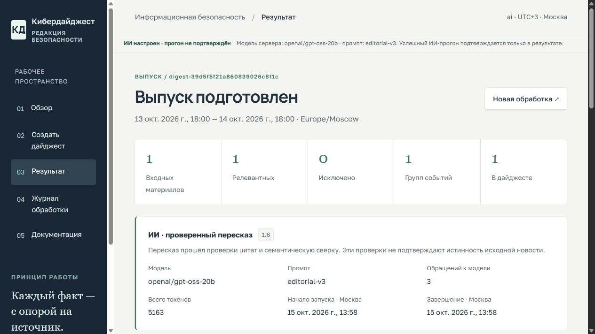

# Реальная проверка Groq

## Разделение версий

Ниже сохранены реальные измерения backend 1.6. Исправления 1.6.1 добавляют безопасную причину отказа, подсказку повтору и возможность нового запроса после fallback; они не означают автоматического улучшения качества. Свежие публичные прогоны после развёртывания фиксируются отдельно в артефактах проверки. [Отчёт исправлений](bugfix-report.md).

15 октября 2026, backend 1.6, исходный код приложения bd3afff67b2deb0b8c3b7af3ba012e0f5d7cbcd2. Переменные изменены только у существующего backend на Render; код, prompts, API, проверки фактов и повторы не менялись. Секрет не включён в исходники, скриншоты или артефакты.

**Подтверждён реальный AI-выпуск на одном учебном событии. Успешная AI-обработка полного набора и конкурсная готовность не подтверждены.**

## Подключение

Groq, базовый URL `https://api.groq.com/openai/v1`, модель `openai/gpt-oss-20b`. Модель поддерживает строгий JSON Schema по [официальной документации Groq](https://console.groq.com/docs/structured-outputs). Совместимость существующего адаптера подтверждена реальными ответами. Ключ хранится в Environment backend и не передаётся frontend.

После обновления окружения Render получил Live: `dep-db8b1d0n74is73ef250g`. `/health` показал `mode=ai`, `llm_configured=true`, модель `openai/gpt-oss-20b`, промпт `editorial-v3`. Это конфигурация сервера; доказательство принятого результата ниже.

## Прогоны через публичный backend

Все входы синтетические, из существующего демо-набора. Время — UTC. HTTP-ответы модели не имитировались.

| Вход | Начало UTC | Результат | Обращений | Токены | Время запроса |
| --- | --- | --- | --- | --- | --- |
| 1 публикация об уязвимости с оговоркой | 10:55:05 | fallback, 1 событие | 3 | 5403 | 4,125 с |
| 1 публикация об остановке системы | 10:58:34 | **ai, 1 событие** | 3 | **5163** | 3,844 с |
| Полный набор, 16 публикаций | 11:00:09 | fallback, 5 событий | 3 | null | 5,750 с |
| 1 публикация с prompt injection | 11:01:08 | fallback, 1 событие | 3 | null | 3,078 с |

Во всех четырёх результатах шесть итоговых проверок прошли. Это подтверждение безопасного результата, а не четыре успешных AI-пересказа. Доступность токенов честно различена: если хотя бы одно обращение не вернуло измеренный usage, общий итог остаётся `null`.

### Принятый AI-выпуск

- `mode=ai`, `model_name=model_version=openai/gpt-oss-20b`, `prompt_version=editorial-v3`.
- `started_at=2026-10-15T10:58:34.862734+00:00`, `completed_at=2026-10-15T10:58:38.503886+00:00`.
- `llm_attempts=3`: `editorial_v2`, `rewrite_v3`, `semantic_v3` — все `valid=true`.
- `token_usage`: input 2869, output 2294, total 5163.
- Все предложения получили `entailed=true`; дайджест 374, пост 295 знаков без URL. Источник и последствие «работа информационной системы временно приостановлена» сохранены.
- API validate вернул valid=true; JSON/CSV экспорт получили HTTP 200. Публичный интерфейс показал фактическую модель, промпт, обращения, токены и режим.

### Почему был fallback

Первый материал прошёл редакционный план, но оба ответа пересказа были отклонены. Отдельный реальный диагностический ответ подтвердил, что модель добавляет неподтверждённую лексику и меняет оговорку вопреки правилам. Проверка `verify_copy` его отклонила; ослаблять её не стали. Диагностическое обращение дополнительно израсходовало 2219 токенов и не включено в три обращения серверного результата.

На полном наборе принят редакционный план, после чего оба обращения пересказа завершились без принятого ответа. Точная транспортная причина не определена безопасной телеметрией; считать её доказанной ошибкой квоты или качества нельзя. На входе с prompt injection один ответ пересказа получен, но не принят, другой завершился без принятого ответа. Инструкция не попала в опубликованные дайджест/пост; это не подтверждает устойчивость принятого AI-пересказа к любым атакам.

Groq описывает ограничения бесплатного плана, в том числе TPM, в [rate limits](https://console.groq.com/docs/rate-limits); фактические квоты аккаунта могут отличаться. Строгая JSON-схема не гарантирует сохранения смысла и оговорок.

## Артефакты и границы проверки

`artifacts/live-ai-2026-10-15/` содержит input/result/report четырёх прогонов, диагностический ответ, дополнительные проверки и JSON/CSV принятого выпуска. Папка исключена из Git и сохраняется в локальной копии проекта. После нового деплоя SQLite может потерять эти выпуски; артефакты и скриншот сохраняют измеренные результаты.

Этот этап меняет конфигурацию и документацию, а не код приложения. Предыдущие 101 Python-тест, 30 frontend-тестов, Docker и responsive-проверки описаны в [presentation-report.md](presentation-report.md); они не подменяют реальные прогоны этой страницы.

Остаются ограничения: полный AI-набор вернулся к fallback, набор организаторов отсутствует, семантический запрос использует ту же модель, первичный источник выбирается эвристически. Полная достоверность входных новостей, production-нагрузка, постоянное хранение и внешняя PostgreSQL не подтверждены. Результат можно демонстрировать с AI на проверенном входе и с безопасным локальным режимом на остальных.
